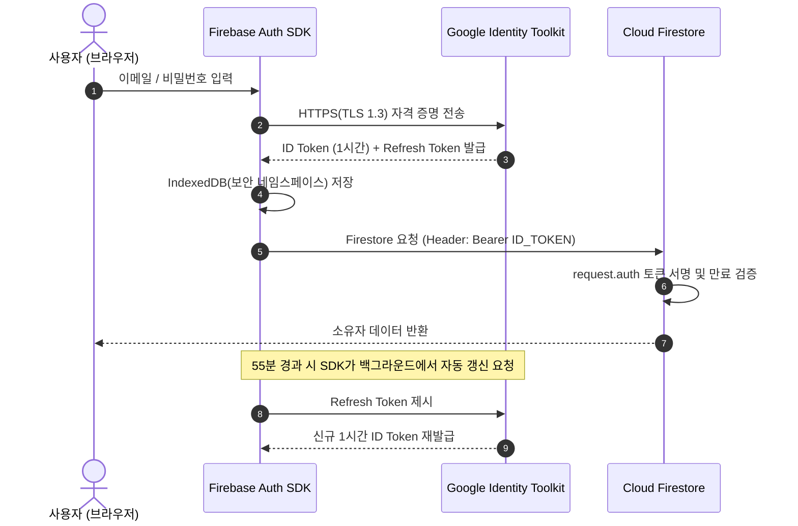

# 과제 7 인증 구현 명세 및 5일 관찰 리포트 (M0)

## 1. 인증 솔루션 개요 (무엇으로 붙였나)

- 채택 솔루션: `Firebase Authentication (Email/Password)`
- 클라이언트 SDK: `@firebase/auth` (Firebase Web Modular SDK v12.19.0)
- 인프라 환경: Cloud Firestore (`pds-diary-t06`), Firebase Hosting
- 토큰 연동: Cloud Firestore 보안 규칙 내부 `request.auth` 컨텍스트 직결

## 2. 기술 선정 사유 및 대안 비교 (왜 그걸 골랐나)

### 2.1 채택 사유 (Firebase Authentication)

- **인프라 네이티브 토큰 검증**:
  - Cloud Firestore와 동일한 Google Identity Platform 기반으로 동작합니다.
  - 클라이언트가 별도 인증 프록시 없이 Firestore 엔진에 직접 보안 토큰(`request.auth`)을 전달합니다.
- **무서버(Serverless) 보안 경계 확보**:
  - 독립된 인증 백엔드 서버를 직접 호스팅하지 않습니다.
  - 비밀키(Private Key) 노출 및 서버 침해 사고 위험을 원천 차단합니다.
- **클라이언트 자격 증명 격리**:
  - 브라우저 `IndexedDB`의 격리된 네임스페이스(`firebaseLocalStorageDb`)에 인증 상태를 저장합니다.
  - 평문 비밀번호를 브라우저 스토리지에 남기지 않습니다.

### 2.2 검토 후 기각된 대안 비교

| 비교 항목 | 채택안: Firebase Auth | 대안 A: 자체 Node.js JWT 서버 | 대안 B: Supabase Auth / Auth0 |
| :--- | :--- | :--- | :--- |
| **운영 인프라** | 서버리스 완전 관리형 | 별도 Node.js/Express 인스턴스 필요 | 타사 클라우드 인프라 종속 |
| **토큰 검증** | Firestore 엔진 내장 검증 | Firestore 연동 시 Custom Token 재발급 필요 | 외부 JWT 검증에 따른 추가 지연 발생 |
| **시크릿 키 관리** | 구글 인프라 내부 격리 | 서버 호스트 내 서명 비밀키 직접 보관 | 외부 대시보드 API Key 의존 |
| **추가 비용** | 기존 Firebase 인프라 무료 한도 내 사용 | 서버 호스팅(Compute) 비용 상시 발생 | 별도 유료 플랜 및 트래픽 요금 발생 |
| **기각 사유** | - | 비밀키 유출 위험 및 단일 장애점(SPOF) 우려 | 이종 클라우드 분산으로 통신 지연 가중 |

## 3. 비밀번호 암호화 알고리즘 및 솔트 메커니즘 명세

- **암호화 알고리즘**: Modified `scrypt` (구글 고유 메모리 집약적 단방향 해시 함수)
- **알고리즘 동작 파라미터**:
  - `CPU/메모리 비용 파라미터 (Cost Parameter, N)`: $2^{14} = 16,384$
  - `블록 크기 파라미터 (Block Size, r)`: 8
  - `병렬화 파라미터 (Parallelization, p)`: 1
- **솔트(Salt) 정책**:
  - 각 사용자 계정 등록 시 암호학적으로 안전한 난수 생성기(CSPRNG)를 통해 고유 솔트를 생성합니다.
  - 레인보우 테이블(Rainbow Table) 사전 공격을 수학적으로 무력화합니다.
- **서버 서명자 키(Signer Key) 결합**:
  - 사용자별 고유 솔트 외에 Google Identity Platform 인프라 비밀 서명 키를 결합합니다.
  - 데이터베이스 덤프가 탈취되더라도 오프라인 전수 조사 공격을 차단합니다.
- **클라이언트 평문 비밀번호 수명 주기**:
  - 브라우저는 사용자가 입력한 비밀번호를 HTTPS(TLS 1.3) 암호화 터널을 통해 Google Identity Toolkit 엔드포인트로 직접 송신합니다.
  - 송신 직후 브라우저 힙 메모리 변수는 가비지 컬렉터의 수거 대상이 됩니다.
  - `localStorage`, `sessionStorage`, 쿠키, 애플리케이션 로그 어디에도 평문 비밀번호를 기록하지 않습니다.

## 4. 세션 및 토큰 수명 주기 관리 명세

### 4.1 토큰 계층 구조 (OAuth 2.0 / OIDC 기반)

### 4.2 1시간 만료 ID 토큰 (Short-lived ID Token)

- **규격**: RFC 7519 JSON Web Token (JWT)
- **만료 시간**: 발급 시점으로부터 정확히 3,600초 (1시간)
- **페이로드 필수 클레임**:
  - `sub` / `user_id`: Firebase 사용자 고유 식별자 (UID)
  - `iss`: `https://securetoken.google.com/pds-diary-t06`
  - `aud`: `pds-diary-t06`
  - `exp`: 만료 타임스탬프 (발급 후 1시간)
- **역할**:
  - Firestore 요청 시 내부 RPC 인증 헤더에 탑재됩니다.
  - Firestore 보안 규칙의 `request.auth.uid` 변수를 바인딩합니다.

### 4.3 리프레시 토큰 (Refresh Token)

- **수명**: 반영구적 (비밀번호 변경, 계정 삭제, 명시적 세션 취소 시까지 유효)
- **저장 위치**: 브라우저 `IndexedDB` (`firebaseLocalStorageDb` 객체 저장소)
- **자동 갱신 동작**:
  - Firebase SDK는 ID 토큰 만료 5분 전에 비동기 백그라운드 루프를 실행합니다.
  - `securetoken.googleapis.com` 엔드포인트와 통신하여 사용자 인터랙션 중단 없이 새 ID 토큰을 획득합니다.

### 4.4 세션 무효화 (Invalidation on Logout)

- **클라이언트 로그아웃 (`signOut(auth)`)**:
  - 브라우저 IndexedDB에 저장된 ID 토큰 및 Refresh Token을 즉시 영구 파기합니다.
  - SDK 인메모리 인증 객체(`auth.currentUser`)를 즉시 `null`로 전환합니다.
- **서버 측 강제 무효화**:
  - 사용자 비밀번호를 변경하거나 계정을 삭제(`deleteUser()`)하면 Google IDP가 발급된 모든 Refresh Token을 즉시 무효화합니다.

## 5. 인가 및 권한 경계 (Authorization Boundary)

- **원칙**:
  - UI 렌더링 조건문(컴포넌트 숨김)은 편의 기능일 뿐 보안 경계가 아닙니다.
  - 진정한 인가 경계는 백엔드 `firestore.rules`에서 강제합니다.
- **소유권 강제 규칙 규격 (M2 적용 예정)**:
  - `request.auth != null`: 미인증 사용자의 모든 접근을 HTTP 403 (Permission Denied)으로 차단합니다.
  - `resource.data.userId == request.auth.uid`: 타인의 문서에 대한 단일 읽기/수정/삭제를 차단합니다.
  - `request.resource.data.userId == request.auth.uid`: 타인 UID를 위조한 문서 생성/변조를 차단합니다.

## 6. 5일 관찰 프로토콜 및 단일 관찰 지표 고정

### 6.1 관찰 질문

- **연구 질문**: "계획 대비 실제 소요 시간의 오차율(Time Drift Rate)을 줄이기 위해 시작 시간 고정 규칙을 적용하면 일간 완료율이 향상되는가?"

### 6.2 단일 관찰 지표 및 측정 단위

- **단일 관찰 지표**: 계획 실행 완료율 (Completion Rate)
- **측정 단위**: 퍼센트 (`%`)

### 6.3 집계 공식

$$\text{계획 실행 완료율}(\%) = \left( \frac{\text{해당 일자 완료 할 일 수}}{\text{해당 일자 전체 예정 할 일 수}} \right) \times 100$$

### 6.4 5대 예외 처리 규칙

1. **결측치 (Missing Values) 처리 규칙**:
   - 해당 일자에 등록된 예정 할 일이 0건인 경우, 분모가 0이 되어 나눗셈 불가(Undefined) 상태가 됩니다.
   - 해당 일자는 결측치로 분류하여 완료율 산출 대상에서 제외합니다.
   - 5일 전체 종합 평균 계산 시 유효 일수(분모)에서 제외합니다.
2. **중복값 (Duplicate Values) 처리 규칙**:
   - 네트워크 재시도 또는 사용자의 연속 클릭으로 동일 할 일의 완료 신호가 중복 유입될 수 있습니다.
   - 과제 6의 멱등성 트랜잭션 가드(`runTransaction`)를 유지하여 최초 1건만 완료 상태로 승인하고 후속 요청은 무시합니다.
3. **이상치 (Outliers) 처리 규칙**:
   - 하루 계획 할 일 수가 10건을 초과하는 극단적 분할은 튀는 값으로 판정합니다.
   - 측정 왜곡을 방지하기 위해 원래의 상위 작업 단위로 재결합하여 1건으로 보정 집계합니다.
4. **반올림 (Rounding) 규칙**:
   - 나눗셈 결과 소수점이 발생하는 경우 소수점 둘째 자리에서 반올림하여 소수점 첫째 자리까지 표기합니다.
   - 예시: $66.666\dots\% \rightarrow 66.7\%$, $33.333\dots\% \rightarrow 33.3\%$.
5. **주 시작 요일 (Week Start Convention) 규칙**:
   - ISO 8601 및 국내 주간 업무 표준에 맞춰 월요일(Monday)을 주의 시작으로 규정합니다.

### 6.5 3일차 진입 전 계획 규칙 변경 기준

- **규칙 변경 시점**: Day 2 관찰 기록 마감 후 - Day 3 첫 계획 수립 및 착수 전 (타임스탬프 기록).
- **변경 전 계획 규칙 (Day 1 - Day 2)**:
  - "마감 시각(23:30 KST) 전까지 완료하면 작업 시작 및 종료를 자유롭게 분산하여 착수함."
- **변경 필요성 진단 기준**:
  - 1일차와 2일차의 계획 대비 실제 소요 시간 오차율(Time Drift) 실측 결과를 확인합니다.
  - 자유 착수 시 발생하는 지연 병목을 구체적 데이터로 확인하고 변경 근거로 제시합니다.
- **변경 후 계획 규칙 (Day 3 - Day 5)**:
  - "할 일 착수 시 반드시 30분 단위 블록으로 시작 시각을 고정하고, 착수 시각 기준 10분 이상 지연 시 지연 사유를 기록함."
- **불변 원칙**:
  - 계획 수립 및 착수 규칙이 변경되더라도, 단일 관찰 지표(`%`), 집계 공식 및 5대 예외 처리 규칙은 5일 동안 100% 동일하게 유지합니다.
